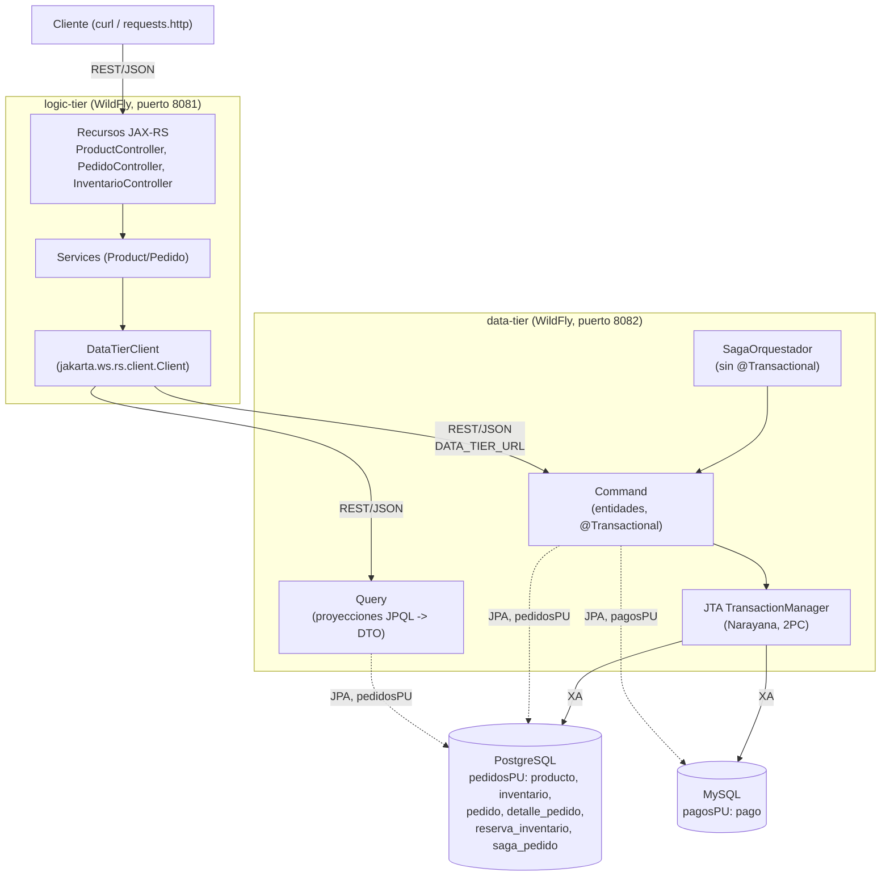
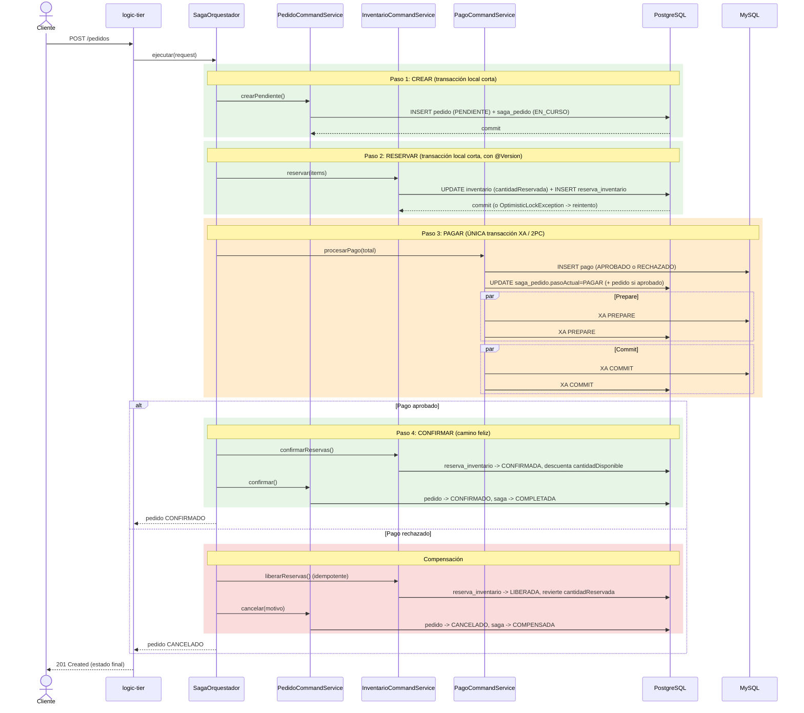

# Arquitectura

## Diagrama de componentes

El logic-tier no tiene base de datos propia: es una fachada que valida
(Bean Validation) y traduce al data-tier. El data-tier separa comando y
consulta (CQRS) y coordina la saga; el `TransactionManager` de WildFly
(Narayana) es quien realmente ejecuta el 2PC cuando un mismo método toca
PostgreSQL y MySQL a la vez (paso "procesar pago").

## Diagrama de secuencia de la saga

Si el paso RESERVAR falla por stock insuficiente, no hay nada que
compensar (ninguna reserva llegó a confirmarse): el orquestador llama
directamente a `cancelar()` sobre el pedido. Si una compensación lanza una
excepción, el orquestador marca la saga como `FALLIDA` con el error, en
vez de dejarla en un estado ambiguo.
